# MirrOS — Duplicación y control de iPhone por USB en Windows y Linux (`scrcpy` para iOS)

<p align="center">
  <strong><a href="README.md">🇺🇸 Read in English</a></strong> ·
  <strong>🇪🇸 Español</strong> ·
  <strong><a href="https://cristiant2608.github.io/mirros/">🌐 Sitio Web Oficial</a></strong> ·
  <strong><a href="https://github.com/Cristiant2608/mirros/releases/latest">⬇️ Descargar última versión (v1.3.0)</a></strong>
</p>

[](https://github.com/Cristiant2608/mirros/releases/latest)
[](https://github.com/Cristiant2608/mirros/releases)
[](https://github.com/Cristiant2608/mirros/actions/workflows/packages.yml)
[](https://github.com/Cristiant2608/mirros/releases/latest)
[](LICENSE)

**MirrOS** permite ver la pantalla, escuchar el audio, grabar vídeo y controlar tu **iPhone por USB desde Windows y Linux** con baja latencia (alternativa de código abierto estilo `scrcpy` para iOS 17.4+ e iOS 18). Incluye una aplicación de escritorio lista para usar (**React + Electron**) y una herramienta de línea de comandos (`mirros` / `ios-scrcpy`) con selector de idioma integrado (**Inglés `EN` / Español `ES`**).

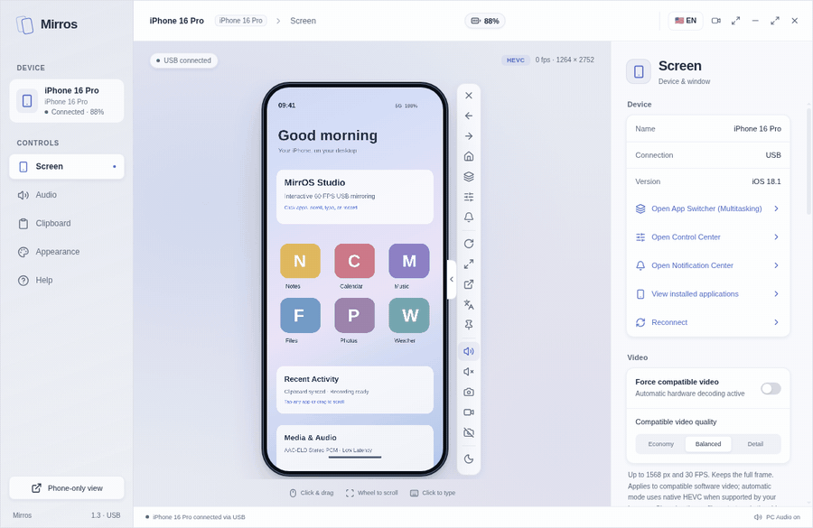

Todas las capturas y vistas animadas del repositorio muestran una pantalla simulada sin datos personales. Las pruebas automáticas y las pruebas con un teléfono físico se registran por separado en [Compatibilidad](docs/COMPATIBILIDAD.md) ([English](docs/COMPATIBILITY.md)).

### MirrOS en acción

<table>
  <tr>
    <td width="56%" align="center">
      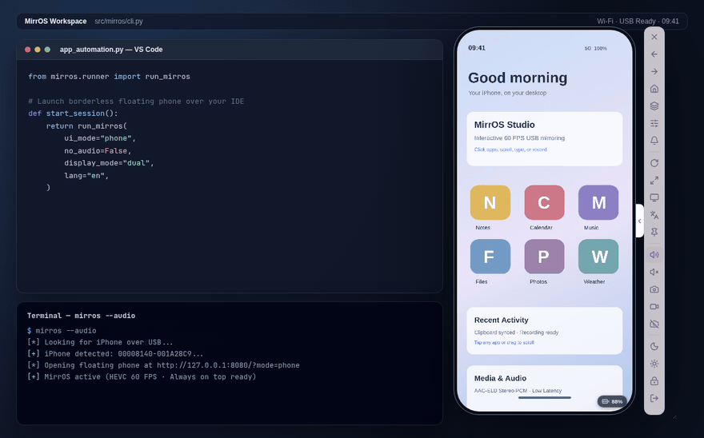<br />
      <sub><strong>Flujo flotante Always-on-Top</strong> — iPhone compacto junto al editor y la terminal, controles plegables y giro instantáneo de 90°.</sub>
    </td>
    <td width="44%" align="center">
      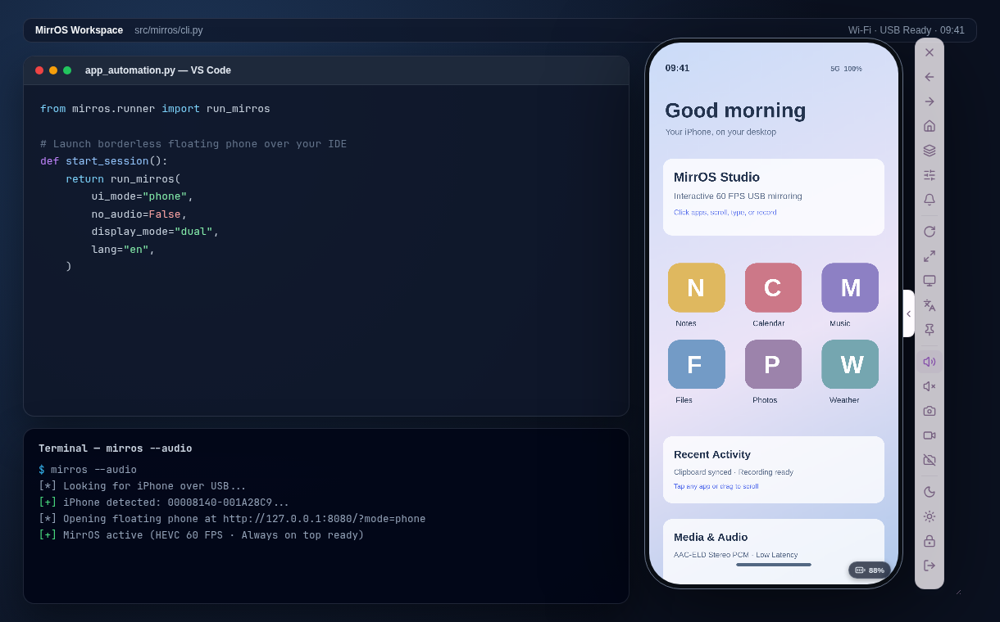<br />
      <sub><strong>Espacio de trabajo lado a lado</strong> — Mantén tu iPhone visible mientras programas o pruebas apps.</sub>
    </td>
  </tr>
</table>

<details open>
<summary><strong>Explorar todas las vistas y modos de la interfaz</strong></summary>

<table>
  <tr>
    <td width="50%" align="center">
      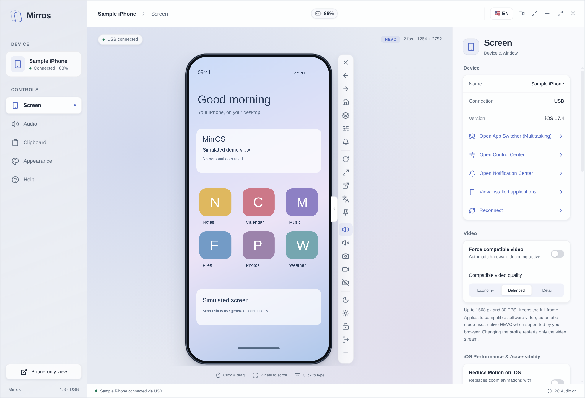<br />
      <sub><strong>Studio (Claro)</strong> — Consola completa con métricas y atajos en vivo</sub>
    </td>
    <td width="50%" align="center">
      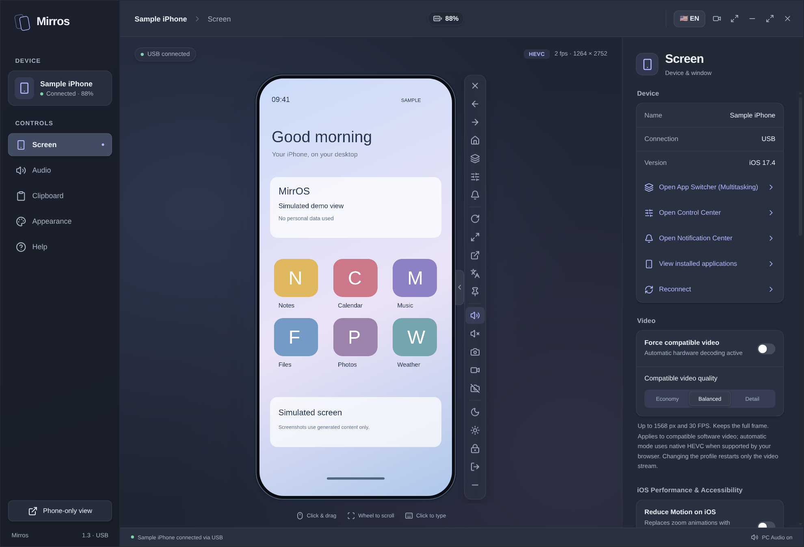<br />
      <sub><strong>Studio (Oscuro)</strong> — Tema de bajo brillo para trabajar</sub>
    </td>
  </tr>
  <tr>
    <td width="50%" align="center">
      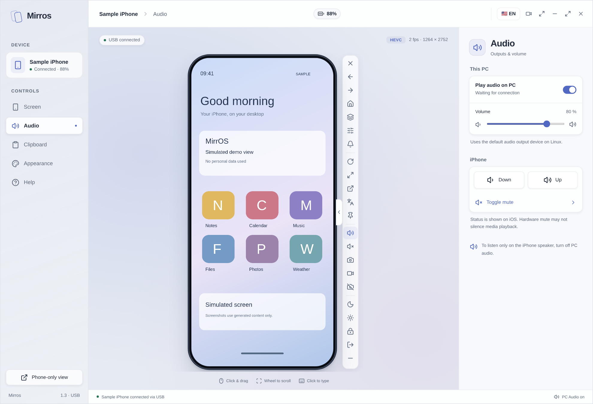<br />
      <sub><strong>Audio y vídeo en tiempo real</strong> — Activa audio USB AAC-ELD y estado del flujo</sub>
    </td>
    <td width="50%" align="center">
      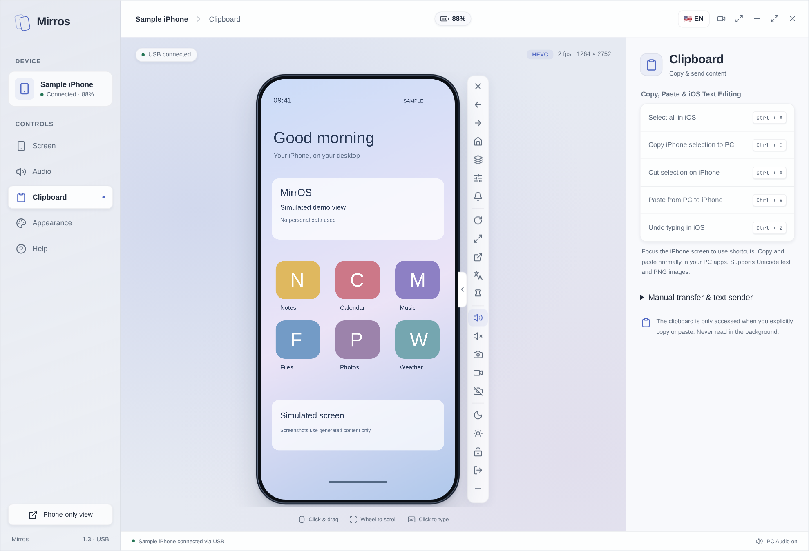<br />
      <sub><strong>Portapapeles y texto</strong> — Envía texto directo del PC al iPhone</sub>
    </td>
  </tr>
  <tr>
    <td width="50%" align="center">
      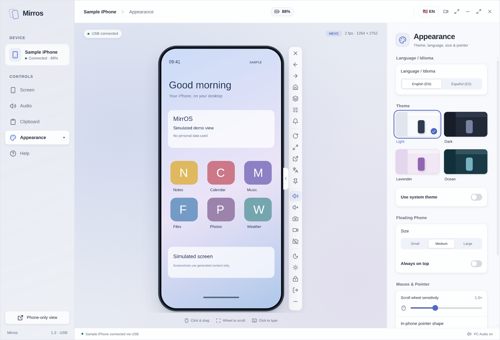<br />
      <sub><strong>Temas, escala e idioma EN/ES</strong> — 4 temas integrados y traducción instantánea</sub>
    </td>
    <td width="50%" align="center">
      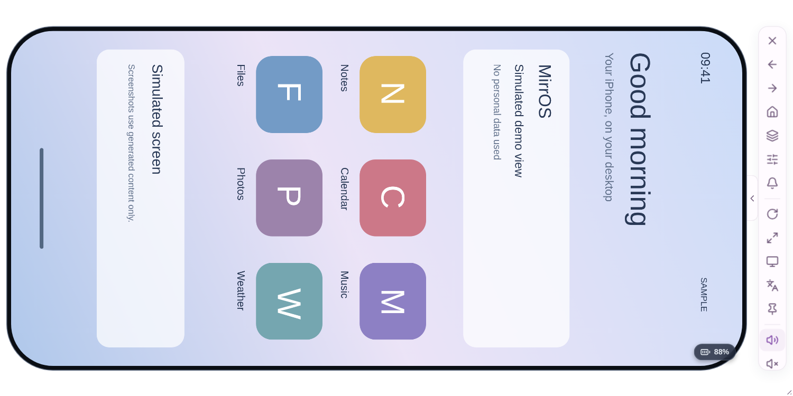<br />
      <sub><strong>Modo flotante horizontal</strong> — Vídeo y marco girados 90° sin bordes</sub>
    </td>
  </tr>
  <tr>
    <td width="50%" align="center">
      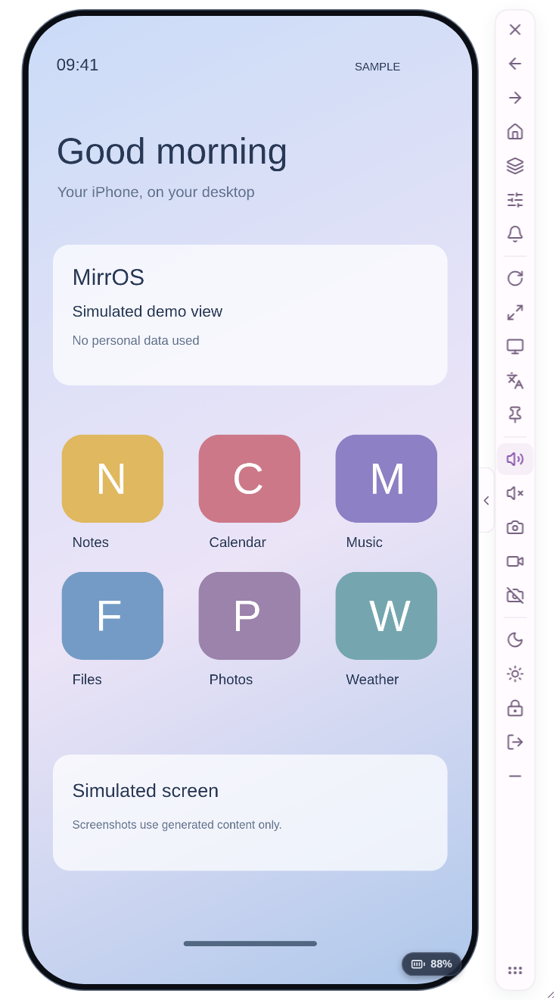<br />
      <sub><strong>Controles flotantes desplegados</strong> — Botones rápidos junto a la pantalla</sub>
    </td>
    <td width="50%" align="center">
      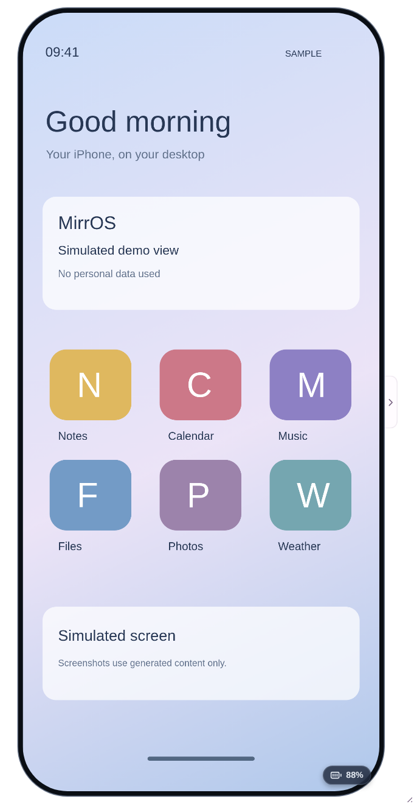<br />
      <sub><strong>Controles flotantes plegados</strong> — Vista minimalista de solo pantalla</sub>
    </td>
  </tr>
</table>

</details>

---

## Características principales

- **Vídeo fluido por USB a 60 FPS (sin caídas de resolución RVRA):** Decodificación HEVC nativa vía WebCodecs con compensación automática de escalones RVRA en Linux/VAAPI y alternativa automática por software (PyAV/MJPEG con perfiles `economy`, `balanced` y `detail`).
- **Control total (ratón, gestos rápidos y teclado):** Toques, arrastres, rueda proporcional, gestos directos para **Centro de Control**, **Centro de Notificaciones** y **Selector de apps (Multitarea)** (`Ctrl+M` / `Ctrl+Tab`), clic derecho para volver a Inicio, puntero personalizable y escritura directa con el teclado del PC (`Ctrl+A`, `Ctrl+C`, `Ctrl+X`, `Ctrl+V` y `Ctrl+Z`).
- **Visor de Cámara en vivo y aislamiento de micrófono:** Al abrir la app Cámara de iOS, MirrOS conmuta automáticamente al visor en directo vía DVT Instruments sin bloqueos por el error CoreDevice 9022.
- **Grabación de pantalla y audio (`Ctrl+Shift+R`):** Exporta grabaciones WebM/MP4 a 60 FPS y capturas PNG (`Ctrl+P`).
- **Ajustes de Rendimiento / Accesibilidad de iOS en vivo:** Conmuta *Reducir movimiento*, *Reducir transparencia* y *Aumentar contraste* directamente desde MirrOS para maximizar la nitidez HEVC.
- **Audio en tiempo real y telemetría de batería:** Reproducción PCM mediante `AudioWorklet` con reserva adaptable, controles de volumen independientes e indicador de batería y modelo del iPhone en vivo.
- **Modo AOD / Reposo y vista de Solo Teléfono flotante:** Permite dejar descansar la pantalla física del iPhone mientras sigues interactuando desde el PC, con vista compacta de solo celular tanto en escritorio como al ejecutar `mirros` por consola.
- **Interfaz bilingüe (`EN` / `ES`):** Inglés por defecto con cambio instantáneo a Español en un clic desde la barra superior, los controles flotantes o la pestaña Apariencia.

---

## Descargar los portátiles

Descarga los archivos desde [GitHub Releases](https://github.com/Cristiant2608/mirros/releases/latest):

| Archivo | Uso |
| --- | --- |
| `Mirros-1.3.0-Windows.exe` | Portátil Windows x64: descargar y abrir. |
| `Mirros-1.3.0-Linux-x64.AppImage` | Portátil Linux x64: dar permiso de ejecución (`chmod +x`) y abrir. |
| `Mirros-1.3.0-Source.zip` | Código fuente de la misma versión. |
| `SHA256SUMS.txt` | Sumas SHA-256 de los archivos publicados. |

En Linux:

```bash
chmod +x Mirros-1.3.0-Linux-x64.AppImage
./Mirros-1.3.0-Linux-x64.AppImage
```

---

## Requisitos

- iPhone desbloqueado, cable USB de datos y confianza concedida al ordenador.
- Modo Desarrollador activado en *Ajustes → Privacidad y seguridad*.
- iOS 17.4+ para el túnel USB en espacio de usuario; las versiones anteriores requieren un túnel externo.
- Linux: servicio `usbmuxd`. Windows: *Apple Mobile Device Service* (instalado mediante Dispositivos Apple o iTunes).

---

## Instalar desde el código

### Linux

```bash
git clone https://github.com/Cristiant2608/mirros.git
cd mirros
./setup.sh
mirros --diagnose
mirros
```

### Windows (PowerShell)

```powershell
.\setup.ps1
.\mirros.cmd --diagnose
.\mirros.cmd
```

### Abrir el escritorio desde el código

```bash
pnpm install
node node_modules/electron/install.js
pnpm run build
pnpm start
```

---

## Comando de terminal (`mirros` / `ios-scrcpy`)

| Opción | Comportamiento |
| --- | --- |
| `--diagnose` | Comprueba entorno, navegador y detección USB sin transmitir. |
| `--version` | Muestra la versión instalada. |
| `--port PUERTO` | Usa un puerto de 1 a 65535; por defecto busca uno libre desde 8080. |
| `--udid UDID` | Selecciona el teléfono; obligatorio cuando hay varios. |
| `--browser RUTA` | Selecciona un navegador Chromium. |
| `--audio` / `--no-audio` | Activa o desactiva el audio inicial del visor. |
| `--force-software` | Fuerza la decodificación de video por software (MJPEG con PyAV). |
| `--video-quality {economy,balanced,detail}` | Selecciona el perfil de calidad/rendimiento para el video por software. |
| `--app-switcher` | Abre el selector de aplicaciones en segundo plano (multitarea) en una sesión activa. |
| `--list-apps` | Lista en la terminal las aplicaciones de usuario instaladas en el iPhone. |
| `--floating` / `--studio` | Abre la vista compacta de solo teléfono flotante (por defecto) o el panel completo Studio (`--studio`). |
| `--lang {en,es}` | Define el idioma inicial de la interfaz (`en` para inglés, `es` para español; también conmutable en la ventana). |
| `--no-userspace` | Usa un túnel externo para el dispositivo. |

---

## Documentación y enlaces

- [🇺🇸 English README](README.md)
- [Guía de uso](docs/USO.md)
- [Arquitectura y responsabilidades](docs/ARQUITECTURA.md)
- [Compatibilidad y validación física](docs/COMPATIBILIDAD.md)
- [Cómo contribuir](CONTRIBUTING.md)
- [Política de seguridad](SECURITY.md)
- [Historial de cambios](CHANGELOG.md)

El código de MirrOS usa la licencia [MIT](LICENSE).
