# MirrOS — iPhone Screen Mirroring & USB Control for Windows and Linux (`scrcpy` for iOS)

<p align="center">
  <strong>🇺🇸 English</strong> ·
  <strong><a href="README.es.md">🇪🇸 Leer en Español</a></strong> ·
  <strong><a href="https://cristiant2608.github.io/mirros/">🌐 Official Website</a></strong> ·
  <strong><a href="https://github.com/Cristiant2608/mirros/releases/latest">⬇️ Download Latest Release (v1.3.0)</a></strong>
</p>

[](https://github.com/Cristiant2608/mirros/releases/latest)
[](https://github.com/Cristiant2608/mirros/releases)
[](https://github.com/Cristiant2608/mirros/actions/workflows/packages.yml)
[](https://github.com/Cristiant2608/mirros/releases/latest)
[](LICENSE)

**MirrOS** is an open-source **iPhone screen mirroring, real-time audio streaming, screen recording, and USB HID control** application for **Windows and Linux** — bringing a native **`scrcpy`-like experience to iOS 17.4 and iOS 18** over a standard USB cable without jailbreak or a Mac.

Powered by `pymobiledevice3` and Apple CoreDevice services, MirrOS provides a unified **React + Electron desktop application** and command-line interface (`mirros` / `ios-scrcpy`) with built-in **English (`EN`) and Spanish (`ES`)** language switching.

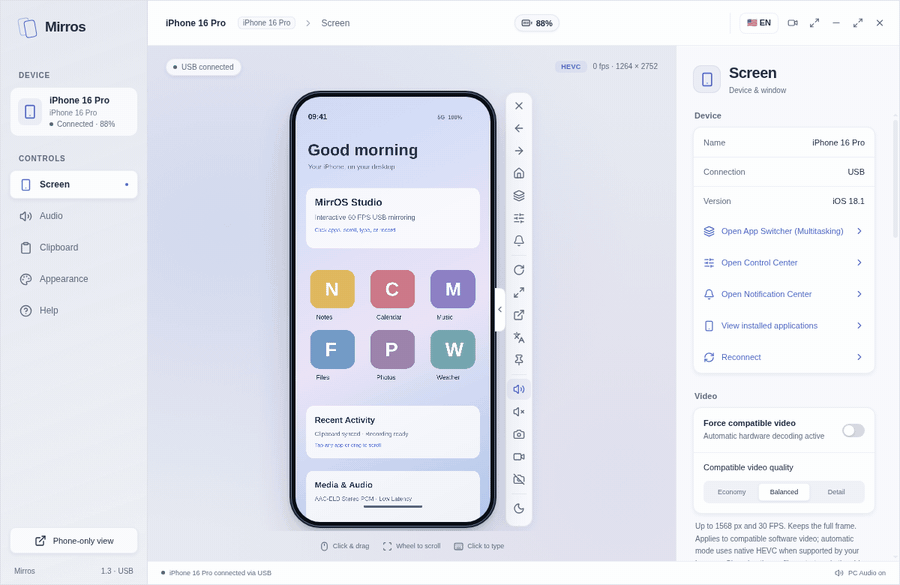

> *All repository screenshots and animated previews use a generated simulated iPhone display and contain no personal device data. Automated CI checks and physical device validations are tracked in [Compatibility](docs/COMPATIBILITY.md) ([Español](docs/COMPATIBILIDAD.md)).*

### MirrOS in Action

<table>
  <tr>
    <td width="56%" align="center">
      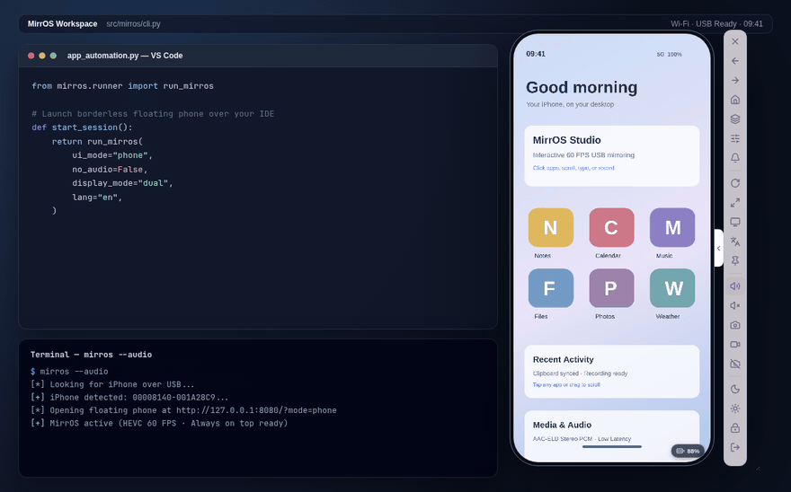<br />
      <sub><strong>Floating Always-on-Top Workflow</strong> — Compact borderless phone over IDE + terminal, collapsible controls, and instant 90° rotation.</sub>
    </td>
    <td width="44%" align="center">
      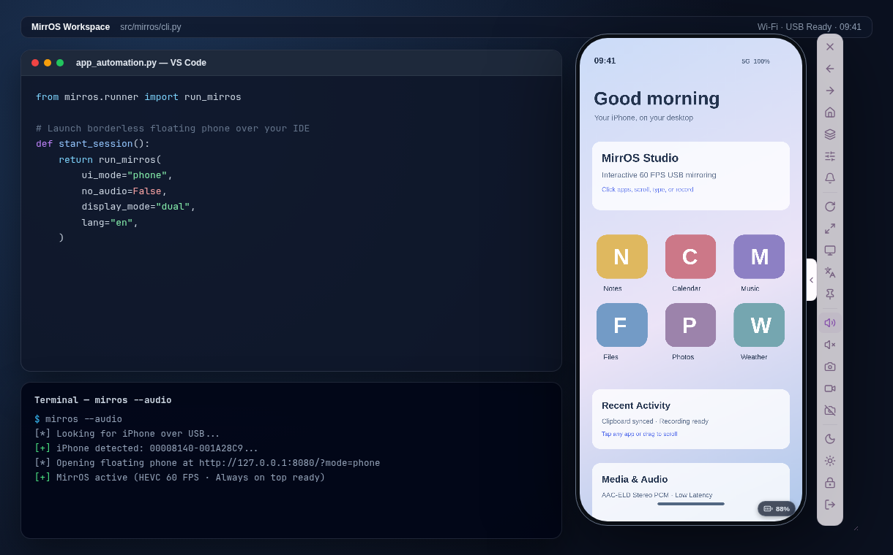<br />
      <sub><strong>Live Side-by-Side Workspace</strong> — Keep your iPhone pinned while coding or testing apps.</sub>
    </td>
  </tr>
</table>

<details open>
<summary><strong>Explore All Interface Views &amp; Modes</strong></summary>

<table>
  <tr>
    <td width="50%" align="center">
      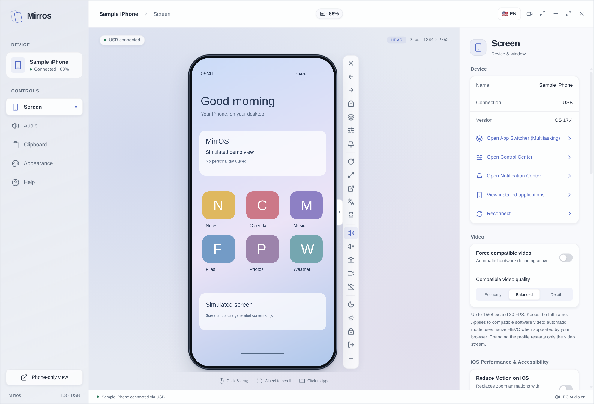<br />
      <sub><strong>Studio (Light)</strong> — Full mirroring console with live metrics and shortcuts</sub>
    </td>
    <td width="50%" align="center">
      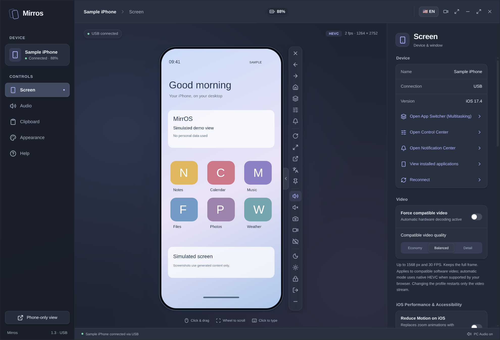<br />
      <sub><strong>Studio (Dark)</strong> — Low-glare workspace theme</sub>
    </td>
  </tr>
  <tr>
    <td width="50%" align="center">
      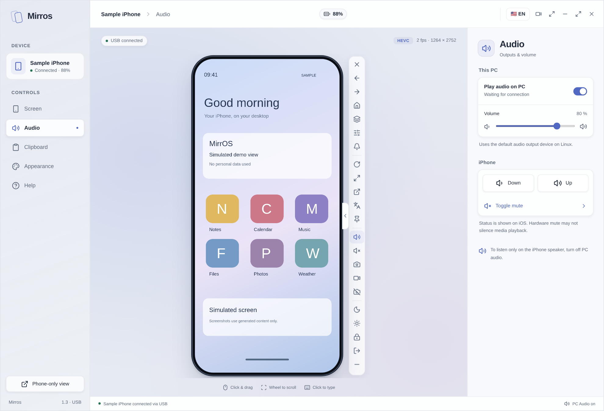<br />
      <sub><strong>Real-Time Audio &amp; Video</strong> — Toggle iPhone USB audio &amp; inspect stream state</sub>
    </td>
    <td width="50%" align="center">
      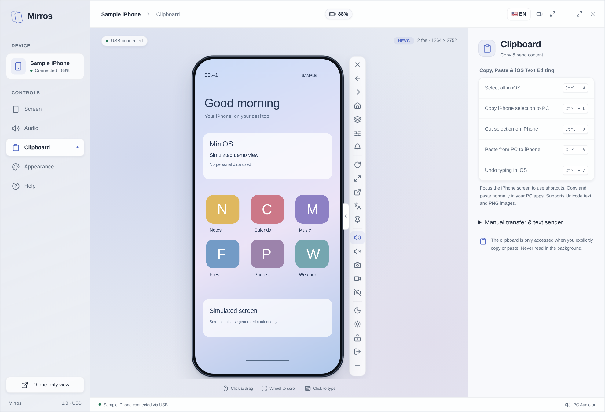<br />
      <sub><strong>Clipboard &amp; Text Entry</strong> — Paste desktop text straight to iPhone</sub>
    </td>
  </tr>
  <tr>
    <td width="50%" align="center">
      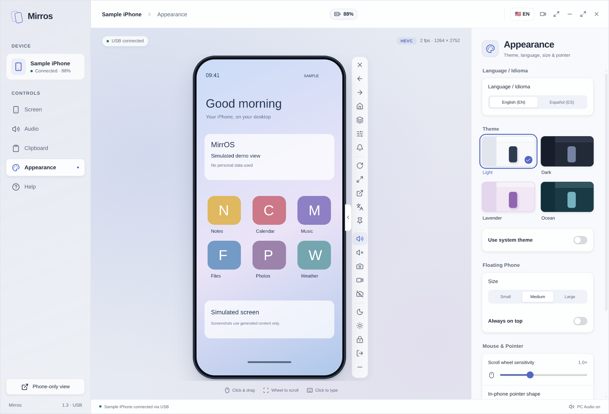<br />
      <sub><strong>Themes, Scale &amp; EN/ES Switcher</strong> — 4 built-in themes + instant UI translation</sub>
    </td>
    <td width="50%" align="center">
      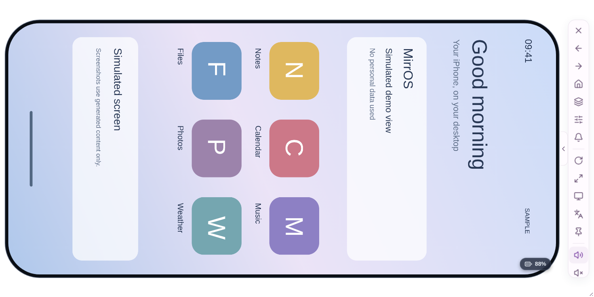<br />
      <sub><strong>Landscape Floating Mode</strong> — 90° rotated video &amp; borderless frame</sub>
    </td>
  </tr>
  <tr>
    <td width="50%" align="center">
      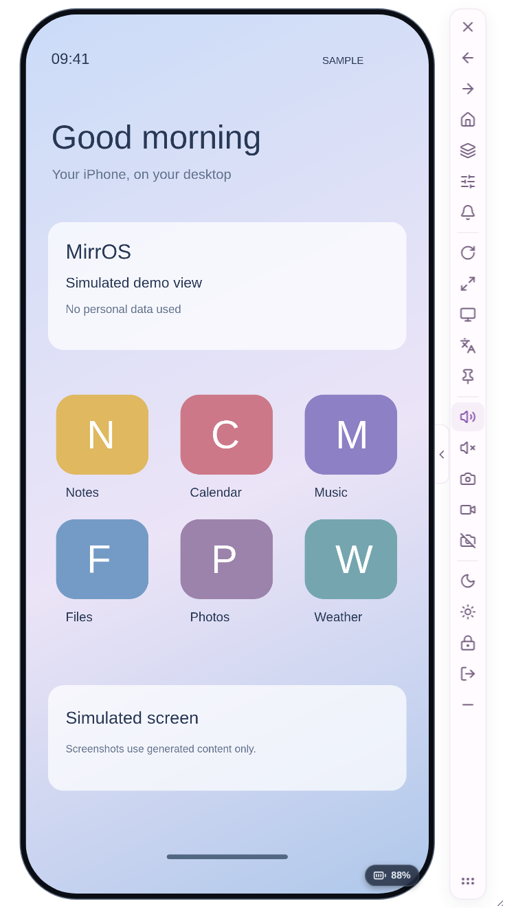<br />
      <sub><strong>Floating Controls Expanded</strong> — One-click shortcuts beside the screen</sub>
    </td>
    <td width="50%" align="center">
      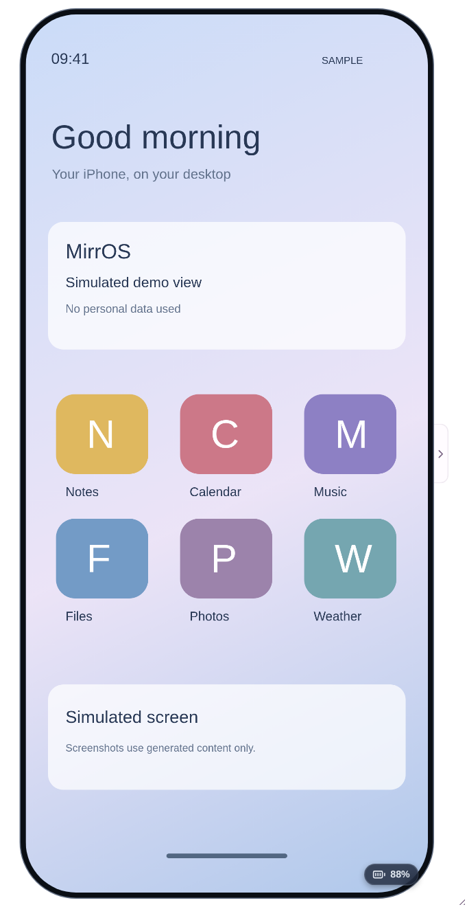<br />
      <sub><strong>Floating Controls Collapsed</strong> — Minimal pure-screen footprint</sub>
    </td>
  </tr>
</table>

</details>

---

## Key Capabilities

| Feature | Description |
| --- | --- |
| **Low-Latency 60 FPS USB Video** | Native **HEVC** hardware decoding via Chromium WebCodecs with automatic Linux/VAAPI RVRA resolution-tier padding detection, plus **PyAV/FFmpeg software fallback** (`economy`, `balanced`, and `detail` profiles). |
| **HID Touch, Edge Gestures & Custom Pointer** | Normalized USB HID touch, long-press hold preservation, proportional mouse-wheel scrolling, 1-click **Control Center**, **Notification Center**, and **App Switcher** gestures, plus a customizable in-phone cursor (Arrow, Circle, Dot). |
| **PC Keyboard, iOS Editing & Bidirectional Clipboard** | Type directly on your iPhone from your PC keyboard with native iOS text shortcuts (`Ctrl+A` Select All, `Ctrl+C` Copy, `Ctrl+X` Cut, `Ctrl+V` Paste, `Ctrl+Z` Undo) and bidirectional Unicode text / PNG image clipboard sync. |
| **Live Camera Viewfinder & Mic Isolation** | Direct live camera feed on canvas via DVT Instruments (`GET /camera-frame`) with touch controls and automatic microphone isolation (avoiding Apple CoreDevice error 9022). |
| **Screen & Audio Recording** | Built-in 60 FPS WebM/MP4 screen + audio recorder (`Ctrl+Shift+R` or toolbar button) alongside instant PNG screenshots (`Ctrl+P`). |
| **Real-Time AAC-ELD Audio** | Streams iPhone audio to your PC using an adaptive `AudioWorklet` jitter buffer (120–240 ms) with independent PC and iPhone volume controls. |
| **Unified Floating Phone & AOD Standby Mode** | Opens by default in a compact, borderless **Floating Phone** window (`mirros` CLI and Desktop) with 1-click switch to the full **Studio** workspace, plus **AOD / Standby Mode** (`Ctrl+L` / `Ctrl+U`) so the physical iPhone screen rests while PC control stays active. |
| **Live iOS Performance & Accessibility Toggles** | Toggle *Reduce Motion*, *Reduce Transparency*, and *Increase Contrast* live on the iPhone via CoreDevice to prevent hardware encoder resolution drops during animations. |
| **Bilingual Interface (`EN` / `ES`)** | English by default with instant 1-click translation to Spanish in both the Floating Phone bar and Studio toolbar. |

---

## Download Portable Packages (No Python or Node.js Required)

Download the latest self-contained binaries from [GitHub Releases](https://github.com/Cristiant2608/mirros/releases/latest):

| File | Platform & Usage |
| --- | --- |
| `Mirros-1.3.0-Windows.exe` | **Windows 10 / 11 (x64) Portable:** download and run the `.exe`. |
| `Mirros-1.3.0-Linux-x64.AppImage` | **Linux (x64) Portable:** make executable (`chmod +x`) and run. |
| `Mirros-1.3.0-Source.zip` | Source code archive from the verified release tag. |
| `SHA256SUMS.txt` | SHA-256 checksums for all release artifacts. |

On Linux:

```bash
chmod +x Mirros-1.3.0-Linux-x64.AppImage
./Mirros-1.3.0-Linux-x64.AppImage
```

---

## System Requirements

1. **Unlocked iPhone**, a **USB data cable**, and **"Trust This Computer"** accepted on the device.
2. **Developer Mode** enabled on the iPhone (*Settings → Privacy & Security → Developer Mode*).
3. **iOS 17.4 or newer** (including iOS 18) for unprivileged userspace USB tunneling (older iOS versions require an external `tunneld` instance).
4. **USB Driver / Service**:
   - **Windows:** *Apple Mobile Device Service* (installed via Apple Devices or iTunes).
   - **Linux:** `usbmuxd` service running (`sudo systemctl start usbmuxd`). On Wayland, install `wl-clipboard` for cross-app clipboard sharing.
5. **Internet connection** may be needed on the very first run so `pymobiledevice3` can fetch the matching Apple Developer Disk Image (DDI).

---

## Install from Source (CLI & Development)

### Linux

```bash
git clone https://github.com/Cristiant2608/mirros.git
cd mirros
./setup.sh
mirros --diagnose
mirros
```

Install system packages according to your distribution:
- **Arch / CachyOS:** `sudo pacman -S --needed usbmuxd chromium wl-clipboard`
- **Debian / Ubuntu:** `sudo apt install usbmuxd chromium wl-clipboard`
- **Fedora:** `sudo dnf install usbmuxd chromium wl-clipboard`

### Windows (PowerShell)

```powershell
.\setup.ps1
.\mirros.cmd --diagnose
.\mirros.cmd
```

Both setup scripts use [`uv`](https://docs.astral.sh/uv/) automatically when available (with `pip` fallback) to create `.venv` and validate package dependencies. The `ios-scrcpy` alias is installed alongside `mirros`.

### Running the Desktop Studio from Source

```bash
pnpm install
node node_modules/electron/install.js
pnpm run build
pnpm start
```

To build standalone distributables locally:
- **Linux AppImage:** `./build-linux.sh` → outputs to `dist/linux/`
- **Windows Portable EXE:** `./build-windows.ps1` → outputs to `dist/windows/`

---

## Command-Line Interface (`mirros` / `ios-scrcpy`)

| Option | Behavior |
| --- | --- |
| `--diagnose` | Checks Python environment, PyAV decoder, browser, and USB detection without starting a stream (redacts UDIDs and private paths). |
| `--version` | Prints the installed MirrOS version. |
| `--udid UDID` | Selects a specific iPhone by UDID (required when multiple devices are connected). |
| `--port PORT` | Binds the local server (`127.0.0.1`) to a specific port (`1–65535`); defaults to the first free port from `8080`. |
| `--browser PATH` | Launches a specific Chromium-based browser binary. |
| `--audio` / `--no-audio` | Enables or disables initial audio streaming in the browser viewer (disabled by default in CLI). |
| `--force-software` | Forces software video decoding (MJPEG via PyAV) instead of WebCodecs HEVC. |
| `--video-quality {economy,balanced,detail}` | Sets the software video profile (`economy`: 20 FPS / 960px, `balanced`: 28 FPS / 1280px, `detail`: 30 FPS / 1568px). |
| `--app-switcher` | Triggers the iOS App Switcher (background multitasking) on an active session. |
| `--list-apps` | Lists user-installed applications on the USB-connected iPhone in the terminal. |
| `--floating` / `--studio` | Opens the compact floating phone view (default) or the full Studio panel (`--studio`). |
| `--lang {en,es}` | Sets initial UI language (`en` English default, or `es` Spanish). |
| `--no-userspace` | Uses an external tunnel instead of the built-in userspace tunnel. |

---

## Keyboard Shortcuts (Viewer Focused)

| Action | Shortcut |
| --- | --- |
| Home Screen | `Ctrl + H` or Right-Click |
| App Switcher (Multitasking) | `Ctrl + M` or `Ctrl + Tab` |
| Copy from iPhone to PC | `Ctrl + C` |
| Cut / Select All / Undo in iOS | `Ctrl + X` / `Ctrl + A` / `Ctrl + Z` |
| Paste from PC to iPhone | `Ctrl + V` |
| Start / Stop Screen Recording | `Ctrl + Shift + R` |
| Save PNG Screenshot | `Ctrl + P` |
| Toggle Fullscreen | `F11` |
| Lock iPhone / AOD Standby | `Ctrl + L` |
| Wake & Unlock Gesture | `Ctrl + U` |
| iPhone Volume Down / Up | `Ctrl + [` / `Ctrl + ]` |
| Invoke Siri | `Ctrl + S` |

---

## Frequently Asked Questions (FAQ)

### Can I mirror and control my iPhone on Linux or Windows without a Mac?
Yes. MirrOS uses iOS 17.4+ CoreDevice services over a standard USB data cable via `pymobiledevice3`, providing full screen mirroring, audio playback, and USB HID mouse/keyboard control on Linux and Windows.

### Does MirrOS require Jailbreak or a paid Apple Developer account?
No. You only need to enable **Developer Mode** in *Settings → Privacy & Security → Developer Mode* on your iPhone and tap **"Trust This Computer"** when connecting over USB.

### How do I switch the interface language between English and Spanish?
MirrOS starts in **English (`EN`)** by default. Click the **`🇺🇸 EN` / `🇪🇸 ES`** button in the Studio top toolbar, the **Languages** icon in the Floating Phone sidebar, or select your language under **Appearance → Language / Idioma**.

---

## Documentation & Project Links

- [🇪🇸 Documentación principal en Español (README.es.md)](README.es.md)
- [Usage Guide](docs/USAGE.md) ([Español](docs/USO.md))
- [Architecture Overview](docs/ARCHITECTURE.md) ([Español](docs/ARQUITECTURA.md))
- [Compatibility & Troubleshooting](docs/COMPATIBILITY.md) ([Español](docs/COMPATIBILIDAD.md))
- [Releases & Update Security](docs/RELEASES.md) ([Español](docs/ACTUALIZACIONES.md))
- [Performance & Linux Hardware Decode Notes](docs/OPTIMIZACION.md)
- [Product & Engineering Roadmap](docs/ROADMAP.md)
- [Contributing Guidelines](CONTRIBUTING.md)
- [Security Policy](SECURITY.md)
- [Changelog](CHANGELOG.md)

MirrOS is released under the [MIT License](LICENSE). Third-party dependencies retain their own licenses; see [NOTICE](desktop/NOTICE.txt).

---

## ⭐ Support & Star History

If **MirrOS** helps you mirror and control your iPhone on Linux or Windows, please consider giving the repository a **⭐ Star** on [GitHub](https://github.com/Cristiant2608/mirros) — it helps other Linux and Windows users discover the project!
