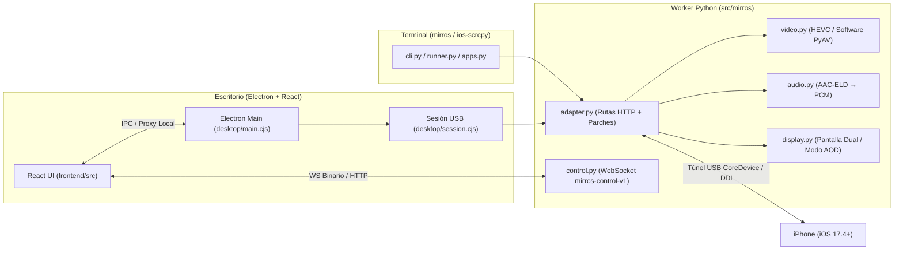

# Arquitectura

MirrOS tiene dos entradas (CLI y escritorio Electron) y un único adaptador del transporte USB sobre `pymobiledevice3`:

## Backend Python (`src/mirros`)

- `cli.py`: argumentos organizados por categorías, ayuda, versión y códigos de salida.
- `runner.py`: detección, preparación DDI, disponibilidad HTTP y visor del navegador con parámetros de calidad/software.
- `apps.py`: consulta de aplicaciones instaladas (`InstallationProxyService`) para `--list-apps` y disparo del selector multitarea (`--app-switcher`).
- `processes.py`: SIGTERM, procesos propios, cierre HTTP con plazo y terminación de respaldo.
- `device.py`: descubrimiento USB nativo y verificación activa del socket `usbmuxd` en Linux; no requiere `idevice_id` ni elige un teléfono arbitrariamente.
- `backend.py`: entrada ejecutable; `adapter.py`: único punto de configuración de
  los parches de `pymobiledevice3`, validación del contrato, liberación de entrada y rutas `/app-switcher`, `/apps` y `/display-mode`.
- `control.py`: servidor WebSocket binario (`mirros-control-v1`) con confirmación por orden tras el despacho HID.
- `display.py`: control de modo de pantalla física (Pantalla Dual vs Modo AOD / Reposo) y gesto HID de despertar/desbloqueo.
- `diagnostics.py`: exportación JSON de diagnóstico técnico libre de UDIDs, rutas de usuario y datos del portapapeles.
- `video.py` y `audio.py`: códecs y alternativa de decodificación por software con perfiles (`economy`, `balanced`, `detail`). El streaming por
  software también depende del contrato privado de suscriptores del backend fijado.

El backend está fijado a 11.32.0. El adaptador comprueba versión, métodos y plantilla
antes de modificar clases. Una actualización de esa dependencia exige revisar
además los campos privados de las sesiones, no solo que las importaciones funcionen.

## Escritorio (`desktop`)

`main.cjs` gestiona ventanas, preferencias, IPC y proxy local. `session.cjs` posee
los procesos USB, preparación, escaneo, selección, desconexión y reconexión, sin
importar Electron. `runtime.cjs` aporta rutas portables y terminación por sistema.
`worker.py` es la entrada de Python que PyInstaller incorpora al paquete.

Las ventanas no poseen el transporte. Cambiar entre panel y teléfono flotante
conserva la sesión. Una generación de conexión impide que resultados de consultas
antiguas reinicien una sesión pausada o cerrada. El sondeo de `/health` detecta
túneles cerrados y más de 20 segundos sin fotogramas, y reconstruye la sesión
aunque el mismo teléfono haya vuelto entre dos escaneos USB. `updates.cjs` verifica y prepara
actualizaciones; `clipboard.cjs` solo transfiere contenido por una acción explícita.

## Interfaz (`frontend/src`)

`main.jsx` monta React; `App.jsx` compone la pantalla. `components` contiene los
controles compartidos. `hooks` separa suscripción al estado, video/orientación,
audio y entrada. `input.js`, `orientation.js`, `video.js` y `audio.js` contienen
la lógica de gestos y medios; `transport.js` concentra las solicitudes de control.

El cliente intenta `/control` con WebSocket y subprotocolo `mirros-control-v1`
para contactos, liberaciones y conjuntos completos de teclas. `control.py`
valida tramas binarias y confirma después de procesar cada orden HID; solo hay
una orden pendiente por cliente. Los manejadores comparten un bloqueo con la
entrada HTTP. El proxy de Electron admite el upgrade únicamente en esa ruta y
con origen local válido. Al cerrar el socket se libera la entrada.

Si no se establece el canal, el cliente conserva POST HTTP y espera cinco
segundos antes de volver a intentar WebSocket. Si una orden ya se envió y se
pierde su confirmación, devuelve error sin repetirla por HTTP. Botones,
portapapeles y demás acciones conservan sus rutas HTTP.

`controlStats()` en el módulo de transporte devuelve contadores y la última
duración cliente→confirmación y de despacho en el servidor, sin registrar
coordenadas ni teclas. Son tiempos del transporte/HID, no latencia hasta que el
cambio aparece en pantalla. Las respuestas HTTP anteriores confirman encolado,
por lo que no deben compararse directamente con estas confirmaciones de despacho.

Las teclas sostenidas renuevan su concesión al backend; perder el foco libera la
entrada. Si desaparece la ventana, la concesión vence para evitar teclas atascadas.

## Construcción y publicación

Vite genera `src/mirros/web`; PyInstaller empaqueta Python; electron-builder genera
EXE/AppImage bajo `dist`. `pyproject.toml` gobierna la versión de Python, Electron
y sus artefactos. CI valida manifiestos, pruebas y ambos paquetes del mismo commit.
Solo las etiquetas estables que coinciden con esa versión y pertenecen a `main`
pueden crear una publicación.
