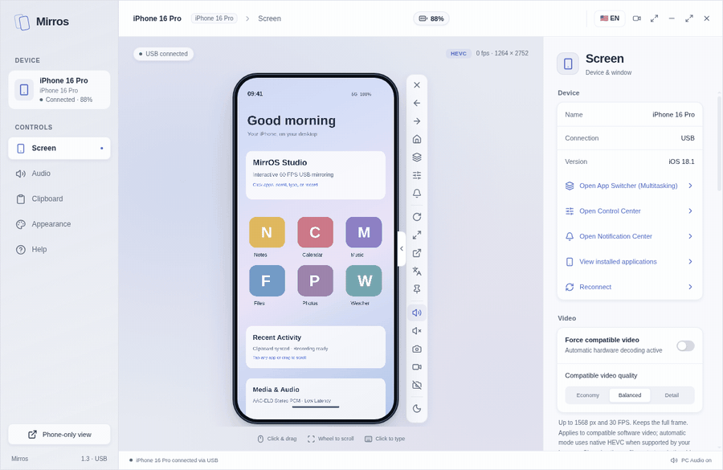
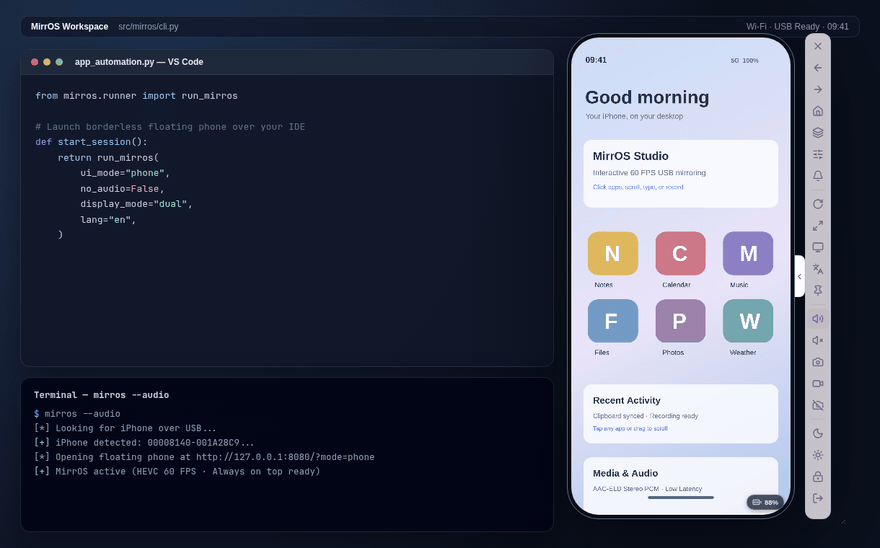
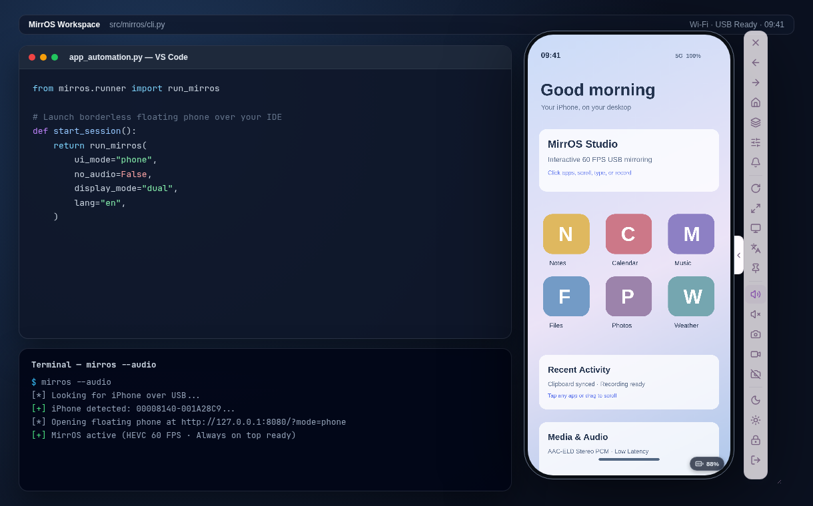
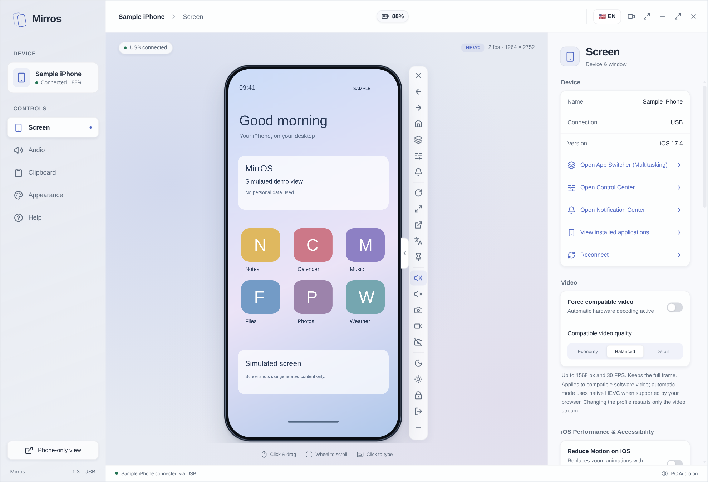
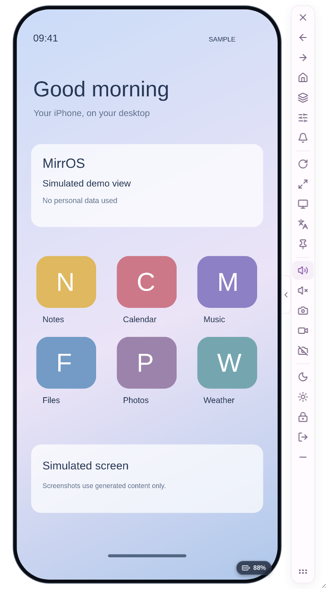
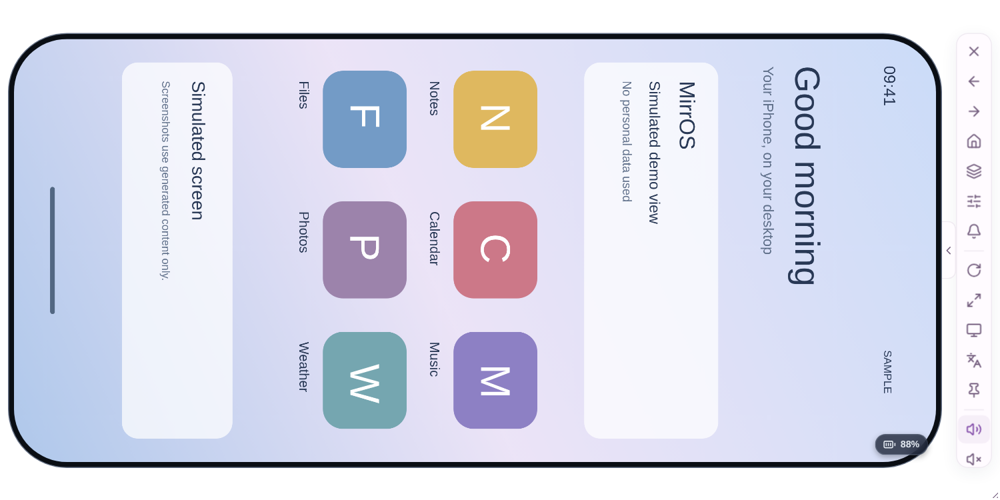
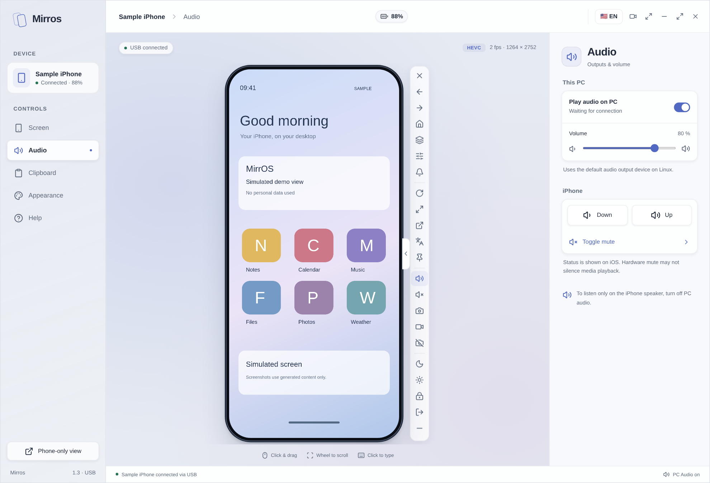
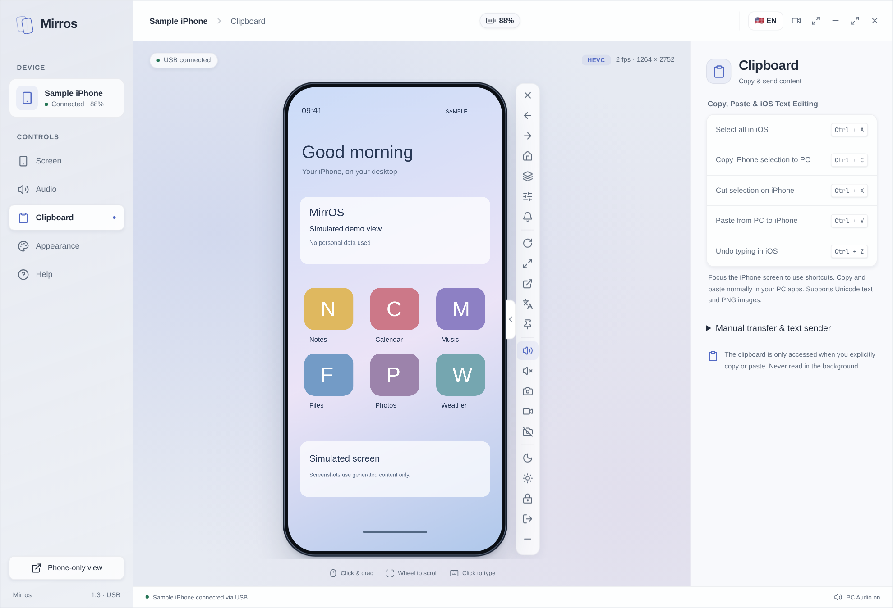
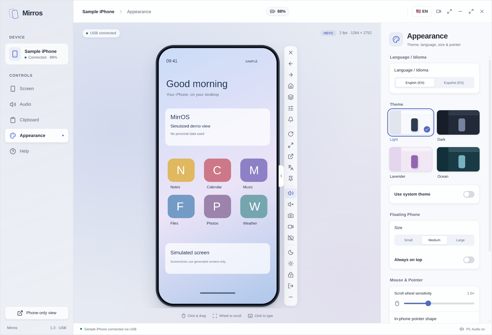

# Usage Guide (`v1.3.0`)

[Versión en español (USO.md)](USO.md)

MirrOS lets you mirror, record, and control your iPhone over USB from Windows or Linux without jailbreak or App Store companion apps.



> *All screenshots and animated previews in this guide use a simulated iPhone screen and contain no personal device data.*

## Requirements

- **PC:** Windows 10/11 or Linux (x86_64) with USB data access (`usbmuxd` on Linux, Apple Devices or iTunes USB driver on Windows).
- **iPhone:** iOS 17 or newer, unlocked over a data-capable USB cable, with **Developer Mode** enabled (`Settings → Privacy & Security → Developer Mode`).
- **Source setup:** Chromium / Microsoft Edge / Chrome (or Electron via `pnpm run desktop`) plus Python 3.10+.

## First-Time USB Setup

1. Connect your iPhone to your PC with a USB data cable.
2. Unlock the iPhone and tap **Trust** when prompted.
3. Enable **Developer Mode** under `Settings → Privacy & Security → Developer Mode` and restart the phone if requested.
4. Launch **MirrOS** (desktop app or `mirros` CLI). On first connection, MirrOS automatically mounts the iOS Developer Disk Image (DDI) over USB.

## Desktop & Floating UI (`v1.3.0`)

MirrOS opens directly in a **compact floating phone window** with a collapsible side control rail so you can keep your iPhone beside an editor, browser, or terminal:





- **Top titlebar:** drag handle, device status indicator, battery telemetry badge, minimize/maximize/fullscreen (`F11`), `EN / ES` language toggle, and close button.
- **Docked control rail:** collapse/expand tab, swipe left/right, Home (`Ctrl+H`), App Switcher (`Ctrl+M`), Control Center, Notification Center, rotate view (`90°`), fit height, open **Studio Panel**, pin always-on-top, PC audio mute, iPhone mute, screenshot (`Ctrl+P`), screen & audio recording (`Ctrl+Shift+R`), camera/microphone live viewfinder toggle, AOD / Standby mode, Wake (`Ctrl+U`), Lock (`Ctrl+L`), and safe disconnect.
- **Studio Panel:** expands the full sidebar workspace with **Screen**, **Audio**, **Clipboard**, **Appearance**, and **Help** tabs (plus application launcher modal and private diagnostics export).

| Mode / Tab | Preview |
| :--- | :--- |
| **Studio Workspace** |  |
| **Floating Side Rail** |  |
| **Landscape Floating Mode** |  |
| **Real-Time USB Audio** |  |
| **Clipboard Sync** |  |
| **Appearance, Themes & Language** |  |

## Keyboard & Mouse Shortcuts

| Action | Shortcut / Input |
| :--- | :--- |
| Tap | Left click on phone screen |
| Swipe / Drag | Click and drag |
| Scroll | Mouse wheel |
| Go Home | Right click or `Ctrl + H` |
| App Switcher | `Ctrl + M` |
| Wake iPhone | `Ctrl + U` |
| Lock / Standby | `Ctrl + L` |
| Save Screenshot (PNG) | `Ctrl + P` |
| Start / Stop Recording (WebM/MP4) | `Ctrl + Shift + R` |
| Fullscreen | `F11` |
| Select All / Cut / Undo (on iPhone) | `Ctrl + A` / `Ctrl + X` / `Ctrl + Z` |
| Clipboard Sync | Standard copy & paste over focused phone view (or manual sync buttons in Studio) |

## Command-Line Interface (`mirros` / `ios-scrcpy`)

```bash
# Default compact floating view (English UI)
mirros

# Open directly in full Studio layout
mirros --studio

# Launch UI in Spanish
mirros --lang es

# Enable PCM audio streaming on startup
mirros --audio

# Force software decoding fallback (recommended on Linux without HEVC hardware support)
mirros --force-software --video-quality balanced

# Specify iPhone UDID, port, or browser executable
mirros --udid <UDID> --port 8080 --browser chromium

# Installed app helpers & diagnostics
mirros --list-apps
mirros --app-switcher
mirros --launch-app com.apple.Preferences
mirros --diagnose
```

For Linux hardware decode & optimization notes, see [OPTIMIZACION.md](OPTIMIZACION.md).
