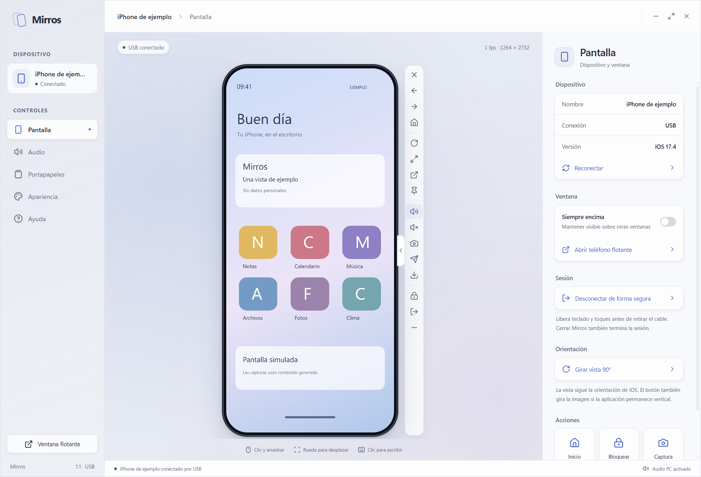
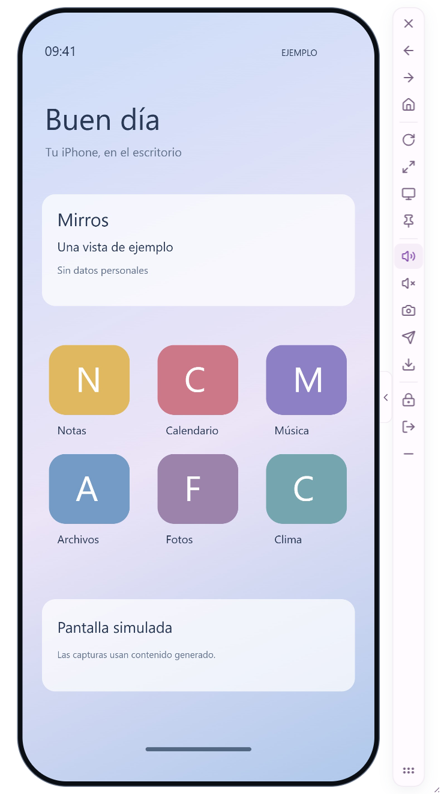
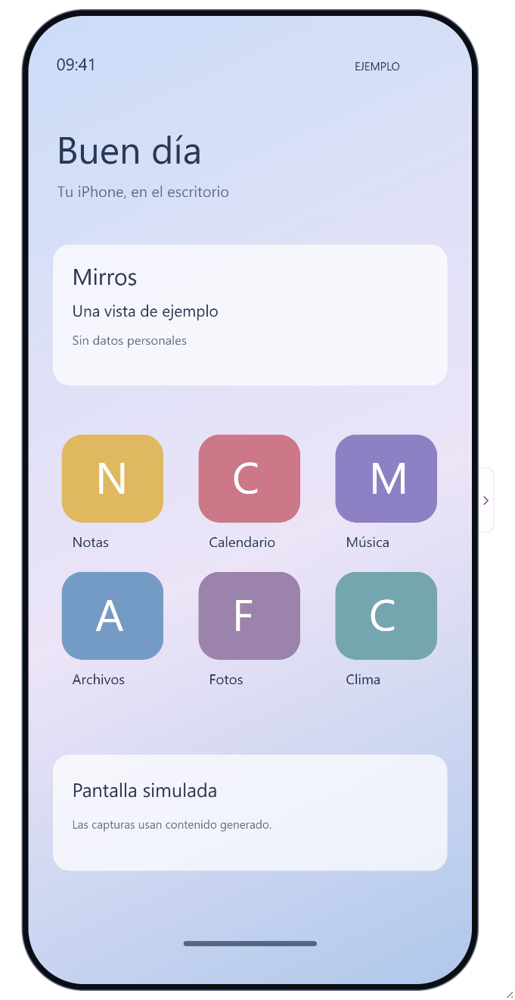
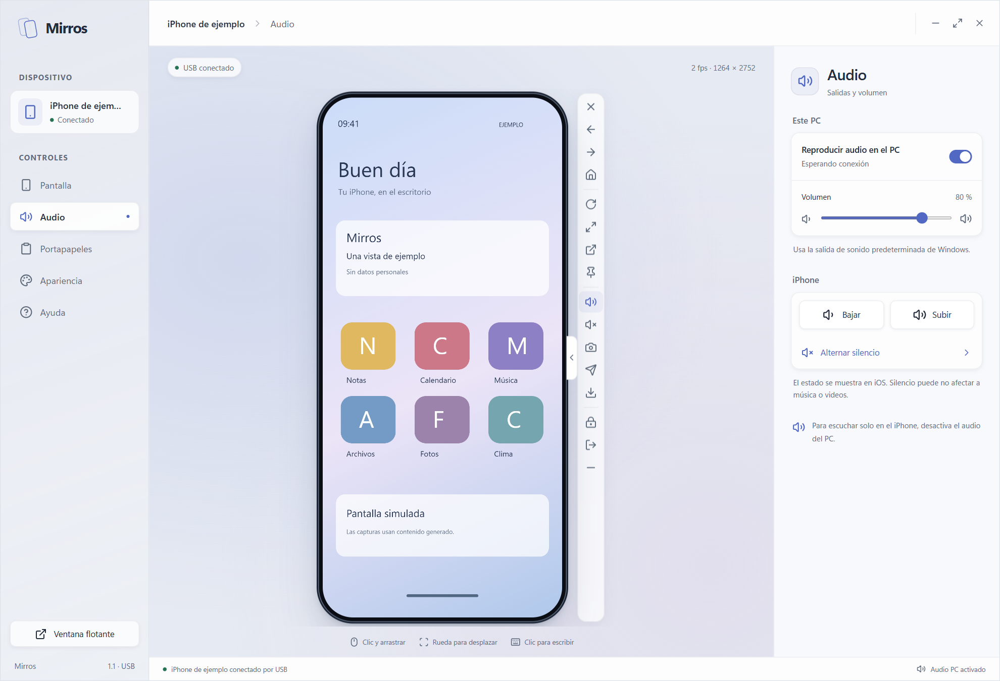
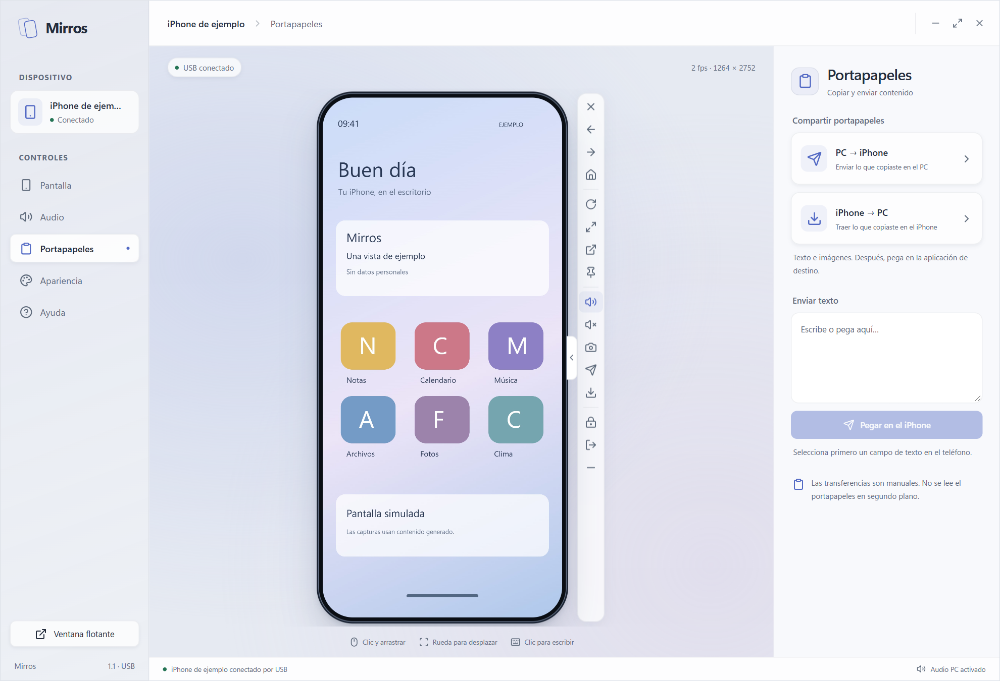
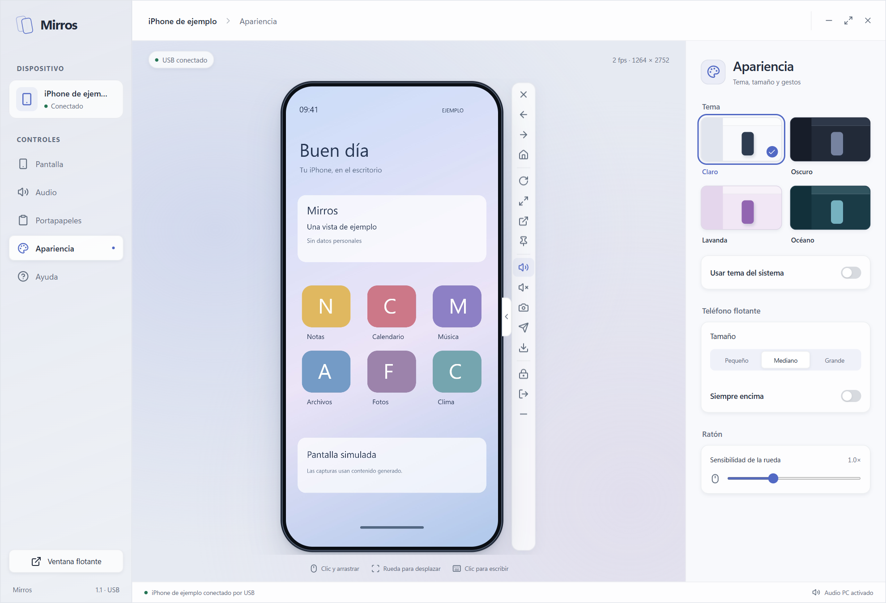
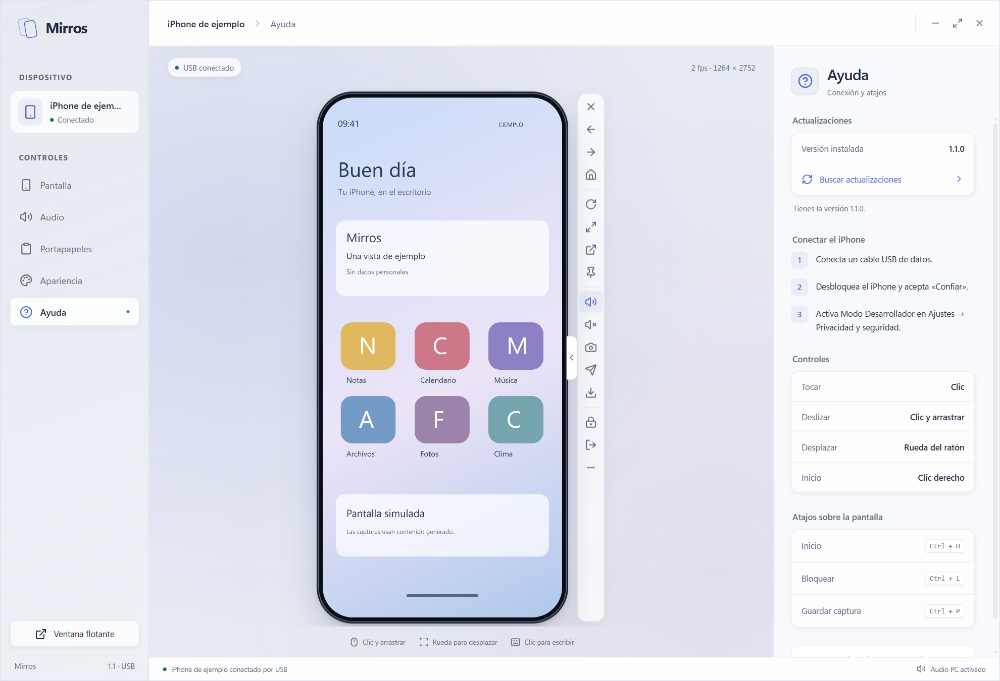

# Guía de uso — Mirros 1.1

## Instalar y conectar

En Windows, descarga `Mirros-1.1.0-Windows.exe` de [Releases](https://github.com/Cristiant2608/mirros/releases). Necesita el servicio USB de Apple, incluido en Dispositivos Apple o iTunes. El EXE incluye Python y Electron.

En Linux, descarga `Mirros-1.1.0-Linux-x64.AppImage`, dale permiso de ejecución y ábrelo:

```bash
chmod +x Mirros-1.1.0-Linux-x64.AppImage
./Mirros-1.1.0-Linux-x64.AppImage
```

Instala `usbmuxd` mediante el gestor de paquetes y comprueba que pueda detectar el iPhone. En Ubuntu: `sudo apt install usbmuxd`; en Arch: `sudo pacman -S usbmuxd`. Para AppImage puede hacer falta FUSE 2 (`libfuse2` en Ubuntu 22.04 o `libfuse2t64` en 24.04). Si FUSE no está disponible, prueba `APPIMAGE_EXTRACT_AND_RUN=1 ./Mirros-1.1.0-Linux-x64.AppImage`.

Guarda el ejecutable en una carpeta donde tu usuario tenga permiso de escritura para poder actualizarlo.

1. Conecta un cable USB de datos.
2. Desbloquea el iPhone y acepta «Confiar en este ordenador».
3. Activa Modo Desarrollador en Ajustes → Privacidad y seguridad.
4. Mantén el cable conectado durante la preparación inicial. Puede descargarse la imagen de desarrollo compatible.

Se recomienda iOS 17.4 o posterior para el túnel USB sin privilegios. El lanzador de terminal admite un `tunneld` externo para versiones anteriores; consulta el README.

## Pantalla y controles



Todas las capturas de esta guía muestran una pantalla generada: no contienen datos ni imágenes de un iPhone real.

Clic para tocar, arrastrar para deslizar y rueda para desplazar. La rueda horizontal también se admite. El clic derecho vuelve a Inicio. Haz clic en el visor para enviar el teclado del PC; al salir del visor se libera la entrada.

La barra vertical queda fuera del teléfono. Su pestaña la guarda bajo la vista y vuelve a desplegarla. La X termina Mirros de forma segura; las flechas envían deslizamientos, porque iOS no ofrece un botón global Atrás como Android.





El icono de monitor vuelve al panel. Arrastra el asa al final de la barra para mover la ventana flotante. Los bordes y esquinas cambian el tamaño del teléfono; los iconos conservan su tamaño. El botón de expandir usa el alto útil del monitor. La chincheta activa «Siempre encima».

«Girar vista 90°» adapta la imagen, la ventana y los toques. También se pide el giro a iOS, pero una aplicación puede permanecer vertical. En ese caso, Mirros lo indica. Los cambios de orientación que comunica la interfaz de iOS se siguen automáticamente.

## Audio



«Reproducir audio en el PC» y su volumen afectan al computador. Los botones del iPhone envían sus propias órdenes de volumen y silencio. Para escuchar solo en el iPhone, desactiva el audio del PC. El botón Silencio de iOS puede no silenciar contenido multimedia; no garantiza escuchar únicamente en el PC.

## Portapapeles



Copia en el PC normalmente, haz clic en un campo del iPhone en MirrOS y pulsa
Ctrl+V para transferir y pegar. Selecciona texto o una imagen en el iPhone y pulsa
Ctrl+C con el visor enfocado; después pega en el PC. En otros campos del PC los
atajos conservan su comportamiento habitual. Las transferencias manuales quedan
en el apartado desplegable. El portapapeles solo se consulta al solicitar una copia.

## Apariencia



Elige Claro, Oscuro, Lavanda, Océano o el tema del sistema. La elección se conserva y se aplica a la barra flotante. Ajusta los tamaños predefinidos y la sensibilidad de la rueda desde Apariencia.

## Terminar sin dejar el teclado conectado

Usa «Desconectar de forma segura» antes de retirar el cable y espera «Sesión terminada». Cerrar Mirros solicita la misma limpieza. Para empezar otra sesión, pulsa Reconectar.

Si quitaste el cable antes, el ordenador ya no puede garantizar que el iPhone reciba la liberación. La aplicación deja de registrar teclados por solicitudes vacías, libera la entrada al perder el foco y cierra el teclado tras cinco segundos de inactividad. La recuperación de imagen y teclado al reconectar fue confirmada con el iPhone de prueba en Linux; otras versiones requieren su propia validación.

## Actualizar



Ayuda → Buscar actualizaciones consulta el repositorio oficial. Cuando hay una publicación nueva para tu sistema, pulsa Descargar y después Reiniciar y actualizar. Mirros comprueba tamaño y SHA-256, termina la sesión y conserva una copia del ejecutable anterior con extensión `.mirros-previous`.

Una modificación en `main` necesita un paquete publicado para actualizar un EXE o AppImage. El flujo de publicación lo genera al crear una etiqueta vVERSION del código integrado en main, después de aprobar las comprobaciones de ambas plataformas. No se instala código de una rama de trabajo sobre un ejecutable.

## Atajos sobre el visor

| Acción | Atajo |
| --- | --- |
| Inicio | Ctrl+H o clic derecho |
| Bloquear iPhone | Ctrl+L |
| Guardar captura | Ctrl+P |
| Volumen del iPhone | Ctrl+[ y Ctrl+] |
| Siri | Ctrl+S |

## Si no aparece imagen

Comprueba cable, confianza, Modo Desarrollador y servicio USB. Cierra Cámara o aplicaciones que estén usando cámara/micrófono y pulsa Reconectar. Ayuda permite abrir el registro de conexión.

Si el navegador no puede decodificar HEVC, el escritorio usa decodificación por software. Esto consume más CPU y puede reducir los fotogramas por segundo. En Linux, comprueba además el compositor: las restricciones de Wayland pueden afectar a transparencia o a mantener ventanas encima; probar X11 permite distinguir un problema del escritorio de uno del transporte USB.

### Imágenes copiadas desde aplicaciones con contenido enriquecido

Una copia desde Notas puede guardar la imagen dentro de otro formato. MirrOS
resuelve ese contenido solo al pulsar la transferencia manual; iOS puede tardar
hasta un minuto y medio. Mantén el teléfono desbloqueado y espera a que termine.
Si no se completa, copia la imagen desde Fotos y repite la transferencia.

### Ctrl+C y Ctrl+V entre el PC y el iPhone

Copia en una aplicación del PC normalmente. Haz clic en un campo del iPhone en
MirrOS y pulsa Ctrl+V: transfiere y pega el contenido. Para traer una selección
del iPhone, selecciónala y pulsa Ctrl+C con la pantalla del teléfono enfocada;
luego pega en la aplicación del PC con Ctrl+V. También se acepta Cmd en el teclado.
Los atajos fuera de la pantalla del teléfono conservan su comportamiento habitual.
En Wayland instala `wl-clipboard` para compartir texto e imágenes con otras
aplicaciones: Arch/CachyOS `sudo pacman -S wl-clipboard`; Debian/Ubuntu
`sudo apt install wl-clipboard`. MirrOS utiliza esas herramientas cuando están
disponibles y conserva la API de Electron como alternativa.
Si iOS no informa un cambio, se trae su portapapeles actual; esto permite copiar
la misma selección otra vez o traer contenido copiado desde el menú del iPhone. Las
transferencias manuales quedan en el apartado desplegable de Portapapeles.

## ¿Puedo usarlo con la pantalla apagada?

Con el transporte USB actual, no. Al dormir o bloquear el iPhone, iOS detiene
la captura de pantalla; el visor necesita el teléfono despierto y desbloqueado.
Puedes reducir manualmente el brillo desde el Centro de control. Eso atenúa
el panel, pero no lo apaga ni equivale a un modo de privacidad.

El [motor utilizado](https://github.com/doronz88/pymobiledevice3/blob/v11.32.0/pymobiledevice3/remote/core_device/screen_stream.py)
mantiene despierto el dispositivo para evitar que se detenga la captura.
[Duplicación del iPhone de Apple](https://support.apple.com/es-co/120421)
permite usar un iPhone bloqueado desde un Mac compatible, mediante otra tecnología;
MirrOS no implementa ese transporte en Windows/Linux.

## Exportar un diagnóstico sin datos personales

Desde una instalación del código fuente:

```bash
python -m mirros.diagnostics --output diagnostico-mirros.json
```

En Windows puedes usar `.venv\Scripts\python.exe`; en Linux,
`.venv/bin/python`. El archivo incluye versiones de Python y dependencias,
sistema/arquitectura y disponibilidad de herramientas. No incluye UDID, nombre
del iPhone, hostname, rutas, variables de entorno, registros ni portapapeles.
No transmite datos a ningún servicio. Solo consulta USB si añades `--probe-usb`;
en ese caso guarda únicamente el número de dispositivos o un estado genérico
si la consulta falla. No inicia una sesión de pantalla.

El destino debe ser un archivo nuevo: no reemplaza archivos existentes ni sigue
un enlace simbólico en ese destino. En POSIX se crea con permisos `0600`.
Sin `--output` imprime el JSON en la terminal. Revisa el informe antes de
adjuntarlo manualmente a una incidencia. Este módulo complementa `mirros
--diagnose`, cuya salida de terminal puede incluir identificadores del teléfono.
